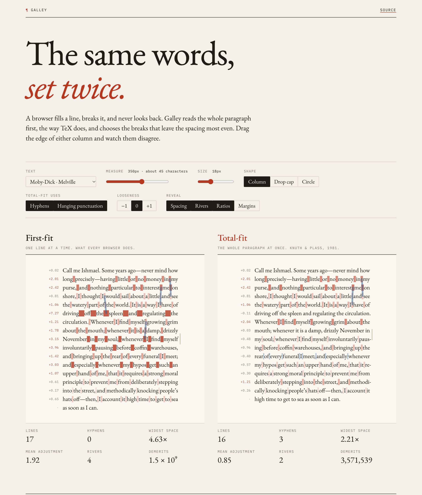
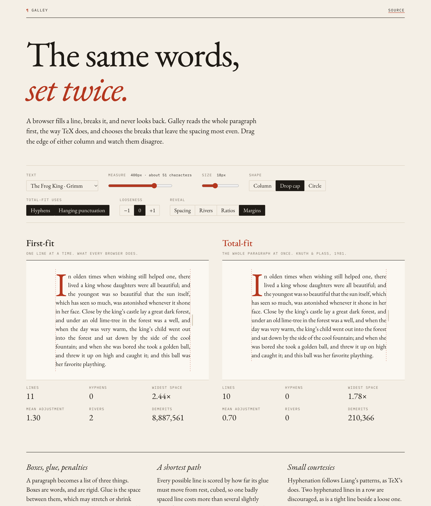
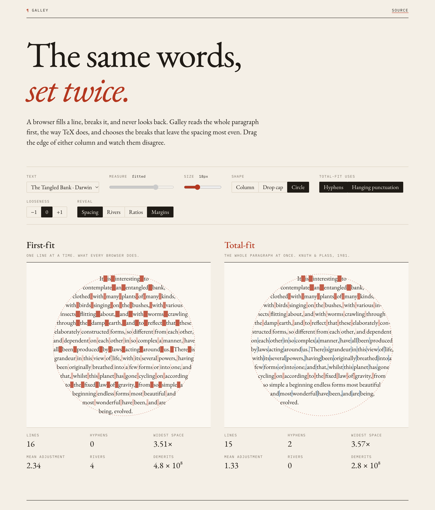

# Galley

[](https://github.com/pMag11-alt/galley/actions/workflows/ci.yml)

A paragraph typesetting engine. It breaks text into lines the way TeX does: by looking at the whole paragraph and choosing the set of breaks that leaves the spacing most even, rather than filling one line at a time.

**[Try it in the browser →](https://pmag11-alt.github.io/galley/)**



The left column is what every browser does with `text-align: justify`. The right column is Galley. Same words, same font, same width. The red tint shows how far each space was stretched, the blue lines trace rivers, and the figures in the margin are each line's adjustment ratio.

## What is in it

- **Knuth–Plass line breaking** with fitness classes, flagged penalties, looseness, an emergency-stretch second pass and an overfull last resort, so it always returns something.
- **Liang hyphenation**, the pattern-matching algorithm from TeX, with the standard US English patterns.
- **Hanging punctuation**: full stops, commas, hyphens and quotation marks protrude slightly into the margin so the edge of the text looks straight.
- **Shaped paragraphs**: every line can have its own width and offset. Drop caps and text poured into a circle use the same breaker.
- **River detection**, for measuring what the breaker is meant to prevent.
- **A greedy first-fit breaker** scored on the same scale, for comparison.
- **A command-line justifier** for monospaced text.

The engine is under a thousand lines of TypeScript with no dependencies. It never touches the DOM: you hand it a function that measures a string, and it hands back positioned text.

| Drop cap, with the margins drawn | Poured into a circle |
| --- | --- |
|  |  |

## Using it

```ts
import { typeset } from './src/core/index.ts';
import { hyphenateEnglish } from './src/core/english.ts';

const ctx = document.createElement('canvas').getContext('2d')!;
ctx.font = '18px "EB Garamond"';

const { lines } = typeset(text, {
  measure: (s) => ctx.measureText(s).width,
  lineWidth: 400,
  lineHeight: 26,
  hyphenate: hyphenateEnglish,
  hang: true,
});

for (const line of lines) {
  for (const run of line.runs) {
    drawText(run.text, run.x, line.y);
  }
}
```

`lineWidth` and `lineOffset` also accept a function of the line number, which is all a shaped paragraph is:

```ts
import { circle, typeset } from './src/core/index.ts';

const disc = circle(200, 26);
typeset(text, { measure, lineWidth: disc.width, lineOffset: disc.offset, lineHeight: 26 });
```

The stages are exported separately (`textToItems`, `breakKnuthPlass`, `breakFirstFit`, `layout`, `findRivers`) for anything `typeset` does not cover.

### In a terminal

```
$ node bin/galley.ts chapter.txt --width 58

Call  me Ishmael.  Some  years ago,  never  mind how  long
precisely,  having little  or no  money in  my purse,  and
nothing particular  to interest me  on shore, I  thought I
would sail about  a little and see the watery  part of the
world. It  is a way I  have of driving off  the spleen and
regulating the circulation.
```

Add `--first-fit` to see the greedy result, or `--no-hyphens` to forbid breaking words. It reads standard input when no file is given.

## How it works

**Boxes, glue and penalties.** `textToItems` turns a paragraph into a flat list. A *box* is a word or a fragment of one, with a fixed width. *Glue* is a space with a natural width, a stretchability and a shrinkability. A *penalty* is a place a line may end and what that costs; a hyphenation point is a penalty that adds the width of a hyphen if it is used.

**Scoring a line.** For a line running from one breakpoint to another, the *adjustment ratio* `r` says how far its glue must move to fill the measure: 0 is untouched, 1 is fully stretched, −1 is fully shrunk. Its badness is `100·|r|³`, so one badly spaced line costs far more than several slightly imperfect ones. Demerits add the cost of the penalty, plus extra for two hyphenated lines in a row or a tight line beside a loose one.

**Finding the best paragraph.** Every legal breakpoint is a node and every feasible line is an edge weighted by its demerits. The best paragraph is the shortest path from the start to the end. [`knuth-plass.ts`](src/core/knuth-plass.ts) walks the breakpoints once, keeping a short list of *active* nodes that a line could still start from, and drops each one as soon as the line from it becomes too long to shrink. That keeps the search close to linear: 20,000 words break in well under a second.

**When nothing fits.** The first pass rejects any line with badness above the tolerance. If that leaves no solution, a second pass pretends every line has a little extra stretch. If that fails too, a third accepts any spacing and, where a single word is wider than the measure, lets it stick out.

**Hyphenation.** [`hyphenate.ts`](src/core/hyphenate.ts) compiles Liang's patterns into a trie. Each pattern is a few letters with digits between them. Every pattern that matches somewhere in a word votes on the gaps it covers; the highest digit at each gap wins, and an odd winner allows a break.

## Checking that it is right

```
npm install
npm test
```

The interesting test is in [`test/breaking.test.ts`](test/breaking.test.ts): for dozens of small random paragraphs it enumerates every possible set of breaks, scores each one, and checks that the breaker's answer has exactly the lowest demerits. It does the same with hyphenation in play and with a different width on every line. The rest cover hyphenation against known words, justification landing exactly on the measure, hanging punctuation, shapes, rivers and the monospace output.

## Running the demo

```
npm run dev
```

The settings are kept in the URL, so a link reproduces what you were looking at.

## Limits

- Hyphenation patterns are US English only. `createHyphenator` accepts any pattern set in the same format.
- Text is assumed to run left to right with spaces between words. There is no bidirectional or complex-script support.
- A paragraph is set in one font at one size.
- Scoring follows TeX closely but not exactly. In particular there is no separate penalty for a hyphen on the second-to-last line.

## Reading

- Donald E. Knuth and Michael F. Plass, *Breaking Paragraphs into Lines*, Software: Practice and Experience, 1981.
- Franklin Mark Liang, *Word Hy-phen-a-tion by Com-put-er*, Stanford University, 1983.
- Hàn Thế Thành, *Micro-typographic extensions to the TeX typesetting system*, 2000.

## Credits

The hyphenation patterns derive from `hyph-en-us.tex`, © Gerard D.C. Kuiken, redistributed under its original notice (see [`src/core/patterns/en-us.ts`](src/core/patterns/en-us.ts)). The demo is set in EB Garamond and IBM Plex Mono, both under the SIL Open Font License. The sample texts are in the public domain.

MIT licensed.
